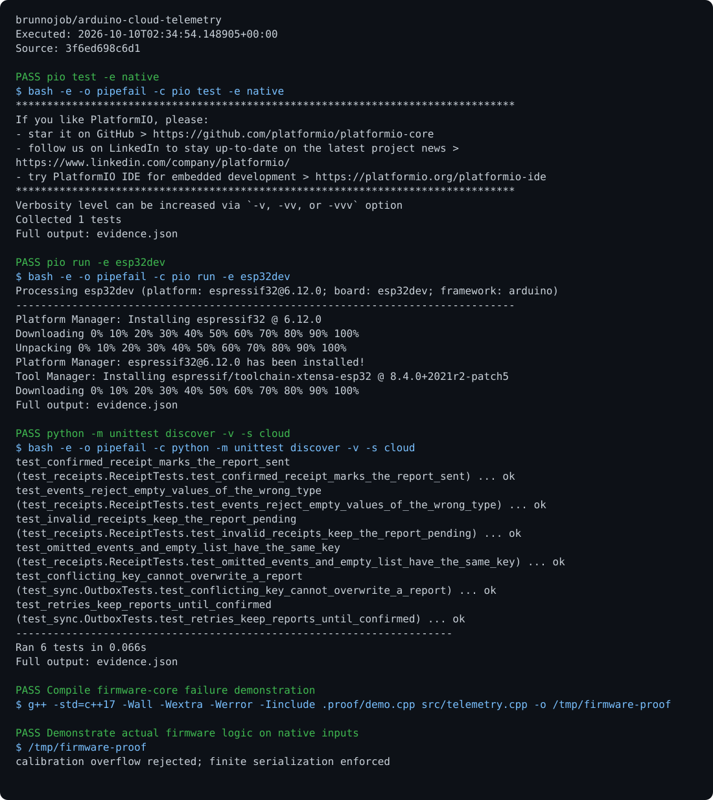

# ESP32 Telemetry

Calibrated acquisition, signal quality, per-sensor sequence numbers, a bounded buffer, and acknowledged serial delivery.

## Run

Requirements: ESP32, C++17, and PlatformIO.

```sh
pio test -e native
pio run -e esp32dev
pio run -e esp32dev -t upload
python -m pip install -r cloud/requirements.txt
python cloud/serial_bridge.py /dev/ttyUSB0
```

## Behavior

ADC uses GPIO 34; serial runs at 115200 baud. Extended uptime handles `millis()` rollover. A boot identifier distinguishes restarts. The bridge retains batches in SQLite. Calibration and pin assignments must match the connected equipment.

## Optional report archive

Export a JSON report from the command above, then run `python cloud/sync.py enqueue result.json --project arduino-cloud-telemetry` and `python cloud/sync.py sync`. Synchronization requires `BRUNNODEV_ACCESS_TOKEN` and the external operations API; the local outbox retains unacknowledged reports.

## License

Original source and documentation are MIT licensed; see [LICENSE](LICENSE). Third-party dependencies and media retain their respective terms. Maintained by [Brunno Dev](https://brunnodev.store).

## Implementation update

Calibration overflow is rejected before consuming a sensor sequence number. Serialization refuses non-finite measurements so invalid numeric values cannot enter a report. Native regression checks are in `tests/runtime_regressions.cpp`.

Contribution trailer: `Co-authored-by: nyctophile <33561761+ineedfoundmyway@users.noreply.github.com>`.

## Execution proof

[](https://github.com/brunnojob/arduino-cloud-telemetry/actions/workflows/proof.yml)



[Verified run](https://github.com/brunnojob/arduino-cloud-telemetry/actions/runs/38017973583) · [Execution report](docs/proof/evidence.json)

Run `python .proof/record.py` after installing the prerequisites above. The scenarios execute repository code and verify exit codes and expected output. CI publishes `execution-proof` with the transcript, input fingerprints and source commit. The downloadable report identifies the exact tested version; the workflow badge tracks the latest run.
